# Sistema de Gestión de Tareas — API REST con Flask y SQLite

- **Alumno:** Reguera, Luciano Oscar
- **Materia:** Programación sobre Redes 
- **Comisión:** D
- **Trabajo:** PFO 2 — Sistema de Gestión de Tareas con API y Base de Datos

API REST desarrollada con Flask que permite registrar usuarios, iniciar sesión y gestionar tareas personales. Las contraseñas se almacenan hasheadas y los datos persisten en una base SQLite. Incluye un cliente de consola que consume la API.

---

## Índice

1. [Funcionalidades](#funcionalidades)
2. [Estructura del proyecto](#estructura-del-proyecto)
3. [Requisitos](#requisitos)
4. [Instalación](#instalación)
5. [Ejecución](#ejecución)
6. [Documentación de la API](#documentación-de-la-api)
7. [Pruebas con curl](#pruebas-con-curl)
8. [Capturas de pantalla](#capturas-de-pantalla)
9. [Respuestas conceptuales](#respuestas-conceptuales)

---

## Funcionalidades

- **Registro de usuarios** (`POST /registro`) con contraseña hasheada mediante `werkzeug.security` (algoritmo *scrypt* con *salt* aleatorio).
- **Inicio de sesión** (`POST /login`) que verifica las credenciales contra el hash almacenado.
- **Gestión de tareas** protegida con autenticación HTTP Basic: listar, crear, modificar, marcar como completada y eliminar.
- Cada usuario accede **solo a sus propias tareas**.
- `GET /tareas` devuelve **JSON** al cliente y una **página HTML de bienvenida** cuando se abre desde un navegador.
- **Persistencia en SQLite**: la base `tareas.db` se crea automáticamente al iniciar el servidor.
- **Cliente de consola** con menús para todas las operaciones. Cualquier operación se puede cancelar con **Ctrl+C**.

## Estructura del proyecto

```
PFO2/
├── servidor.py        # API REST (Flask + SQLite)
├── cliente.py         # Cliente de consola que consume la API
├── requirements.txt   # Dependencias del proyecto
├── capturas/          # Capturas de pantalla de las pruebas
├── README.md          # Este documento
└── tareas.db          # Base de datos (se genera al ejecutar; no se versiona)
```

## Requisitos

- Python 3.10 o superior
- Dependencias (incluidas en `requirements.txt`):

| Librería | Uso |
|---|---|
| Flask | Servidor de la API REST |
| Werkzeug | Hasheo y verificación de contraseñas (`generate_password_hash` / `check_password_hash`) |
| requests | Peticiones HTTP desde el cliente de consola |
| sqlite3 | Base de datos (incluida en la biblioteca estándar de Python) |

## Instalación

1. Clonar el repositorio:

   ```bash
   git clone <URL-del-repositorio>
   cd PFO2
   ```

2. Crear y activar un entorno virtual:

   ```bash
   # Linux / macOS
   python3 -m venv venv
   source venv/bin/activate

   # Windows
   python -m venv venv
   venv\Scripts\activate
   ```

   > En Ubuntu/Debian, si aparece un error sobre `ensurepip`, instalar antes el paquete del sistema: `sudo apt install python3-venv`

3. Instalar las dependencias:

   ```bash
   pip install -r requirements.txt
   ```

## Ejecución

Se necesitan **dos terminales**, ambas con el entorno virtual activado.

**Terminal 1 — Servidor:**

```bash
python servidor.py
```

El servidor queda escuchando en `http://localhost:5000` y crea `tareas.db` si no existe.

**Terminal 2 — Cliente de consola:**

```bash
python cliente.py
```

Opcionalmente se puede indicar otra URL: `python cliente.py http://otro-host:5000`

### Uso del cliente

```
===== Menú principal =====        ===== Tareas (usuario) =====
1. Registrarse                    1. Ver mis tareas
2. Iniciar sesión                 2. Nueva tarea
0. Salir                          3. Marcar completada / pendiente
                                  4. Editar tarea
                                  5. Eliminar tarea
                                  6. Cerrar sesión
                                  0. Salir
```

- La contraseña no se muestra al escribirla y, al registrarse, se pide dos veces para confirmarla.
- Antes de pedir el ID de una tarea, el cliente muestra la lista de tareas del usuario.
- Eliminar y marcar como completada piden confirmación (`s/n`).
- **Para cancelar cualquier operación** se presiona **Ctrl+C**: se vuelve al menú sin realizar cambios. Cada operación lo indica en pantalla.

### Ver las tareas desde el navegador

Con el servidor en ejecución, abrir `http://localhost:5000/tareas`. El navegador solicita usuario y contraseña (autenticación HTTP Basic) y luego muestra la página de bienvenida con las tareas del usuario.

## Documentación de la API

URL base: `http://localhost:5000`

| Método | Endpoint | Autenticación | Descripción |
|---|---|---|---|
| `POST` | `/registro` | No | Registra un usuario nuevo |
| `POST` | `/login` | No | Verifica las credenciales |
| `GET` | `/tareas` | HTTP Basic | Lista las tareas del usuario (JSON o HTML) |
| `POST` | `/tareas` | HTTP Basic | Crea una tarea |
| `PUT` | `/tareas/<id>` | HTTP Basic | Modifica título, descripción o estado |
| `DELETE` | `/tareas/<id>` | HTTP Basic | Elimina una tarea |

### Autenticación

`/login` verifica que el usuario y la contraseña sean correctos, pero el servidor no mantiene sesiones. Los endpoints de `/tareas` se protegen con **autenticación HTTP Basic**: el cliente envía usuario y contraseña en el encabezado `Authorization` de cada petición, y el servidor los verifica contra el hash almacenado. Si faltan o son incorrectos, responde `401 Unauthorized`.

### `POST /registro`

```jsonc
// Petición
{ "usuario": "ana", "contraseña": "1234" }

// 201 Created
{ "mensaje": "Usuario 'ana' registrado correctamente" }
```

| Código | Situación |
|---|---|
| 201 | Usuario creado |
| 400 | Falta `usuario` o `contraseña` |
| 409 | El usuario ya existe |

### `POST /login`

```jsonc
// Petición
{ "usuario": "ana", "contraseña": "1234" }

// 200 OK
{ "mensaje": "Inicio de sesión exitoso. ¡Bienvenido/a, ana!", "usuario": "ana" }
```

| Código | Situación |
|---|---|
| 200 | Credenciales correctas |
| 400 | Falta `usuario` o `contraseña` |
| 401 | Usuario o contraseña incorrectos |

### `GET /tareas`

```jsonc
// 200 OK
{
  "usuario": "ana",
  "tareas": [
    {
      "id": 1,
      "titulo": "Estudiar Flask",
      "descripcion": "Repasar rutas",
      "completada": false,
      "creada_en": "2026-10-11 08:01:27"
    }
  ]
}
```

Si la petición proviene de un navegador (`Accept: text/html`), devuelve una página HTML de bienvenida con la lista de tareas.

### `POST /tareas`

```jsonc
// Petición (descripcion es opcional)
{ "titulo": "Estudiar Flask", "descripcion": "Repasar rutas" }

// 201 Created → devuelve la tarea creada
```

### `PUT /tareas/<id>`

Todos los campos son opcionales; solo se modifican los que se envían.

```json
{ "titulo": "Nuevo título", "descripcion": "Nueva descripción", "completada": true }
```

Responde `200` con la tarea actualizada, o `404` si la tarea no existe o pertenece a otro usuario.

### `DELETE /tareas/<id>`

Responde `200` con `{ "mensaje": "Tarea 1 eliminada" }`, o `404` si la tarea no existe o pertenece a otro usuario.

### Modelo de datos (SQLite)

```sql
CREATE TABLE usuarios (
    id            INTEGER PRIMARY KEY AUTOINCREMENT,
    usuario       TEXT    NOT NULL UNIQUE,
    password_hash TEXT    NOT NULL           -- nunca la contraseña en texto plano
);

CREATE TABLE tareas (
    id          INTEGER PRIMARY KEY AUTOINCREMENT,
    usuario_id  INTEGER NOT NULL REFERENCES usuarios (id) ON DELETE CASCADE,
    titulo      TEXT    NOT NULL,
    descripcion TEXT    NOT NULL DEFAULT '',
    completada  INTEGER NOT NULL DEFAULT 0,
    creada_en   TEXT    NOT NULL DEFAULT (datetime('now', 'localtime'))
);
```

## Pruebas con curl

Con el servidor en ejecución:

```bash
# Registro
curl -X POST http://localhost:5000/registro \
     -H "Content-Type: application/json" \
     -d '{"usuario": "ana", "contraseña": "1234"}'

# Login
curl -X POST http://localhost:5000/login \
     -H "Content-Type: application/json" \
     -d '{"usuario": "ana", "contraseña": "1234"}'

# Crear una tarea (-u envía las credenciales con HTTP Basic)
curl -u ana:1234 -X POST http://localhost:5000/tareas \
     -H "Content-Type: application/json" \
     -d '{"titulo": "Estudiar Flask", "descripcion": "Repasar rutas"}'

# Listar tareas
curl -u ana:1234 http://localhost:5000/tareas

# Marcar la tarea 1 como completada
curl -u ana:1234 -X PUT http://localhost:5000/tareas/1 \
     -H "Content-Type: application/json" \
     -d '{"completada": true}'

# Eliminar la tarea 1
curl -u ana:1234 -X DELETE http://localhost:5000/tareas/1

# Acceso sin credenciales → 401
curl -i http://localhost:5000/tareas
```

Para comprobar que las contraseñas se guardan hasheadas:

```bash
python -c "import sqlite3; [print(tuple(f)) for f in sqlite3.connect('tareas.db').execute('SELECT id, usuario, password_hash FROM usuarios')]"
```

## Capturas de pantalla

### 1. Servidor en ejecución

<!-- Terminal con `python servidor.py` corriendo en http://localhost:5000 -->
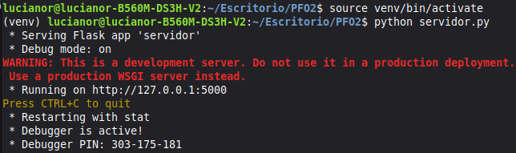

### 2. Registro de usuario

<!-- Cliente: opción 1, registro exitoso ("Usuario '...' registrado correctamente") -->
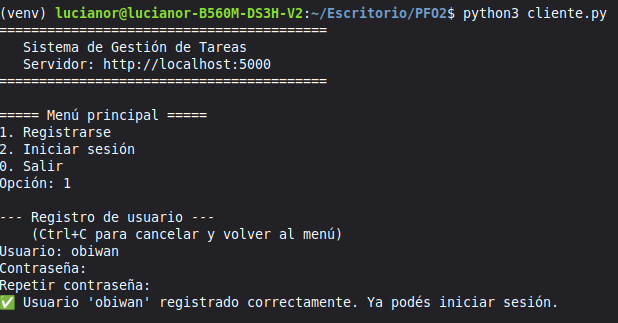

### 3. Inicio de sesión exitoso

<!-- Cliente: opción 2, mensaje de bienvenida y menú de tareas -->
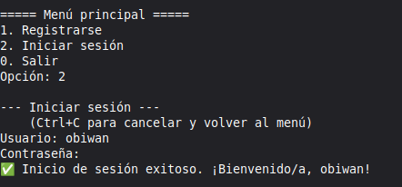

### 4. Inicio de sesión con credenciales incorrectas

<!-- Cliente: login con contraseña incorrecta ("Usuario o contraseña incorrectos") -->
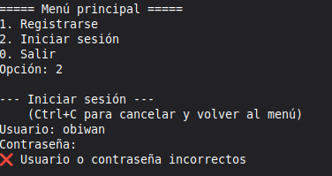

### 5. Crear tareas

<!-- Cliente: opción 2 del menú de tareas, "Tarea #N creada" -->
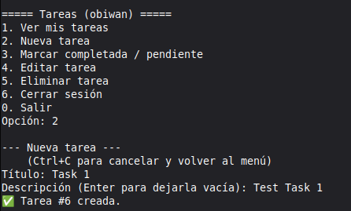

### 6. Listar tareas

<!-- Cliente: opción 1 del menú de tareas, lista con varias tareas -->
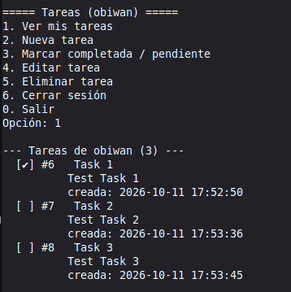

### 7. Marcar tarea como completada

<!-- Cliente: opción 3, confirmación y "marcada como completada" -->
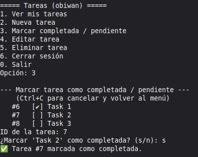

### 8. Editar tarea

<!-- Cliente: opción 4, valores actuales entre corchetes y "Tarea #N actualizada" -->
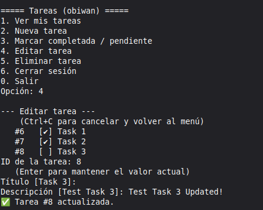

### 9. Eliminar tarea

<!-- Cliente: opción 5, confirmación y "Tarea N eliminada" -->
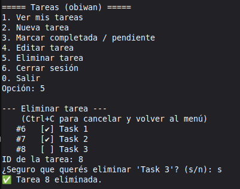

### 10. Cancelar una operación con Ctrl+C

<!-- Cliente: cualquier operación cancelada con Ctrl+C ("Operación cancelada. Volviendo al menú.") -->
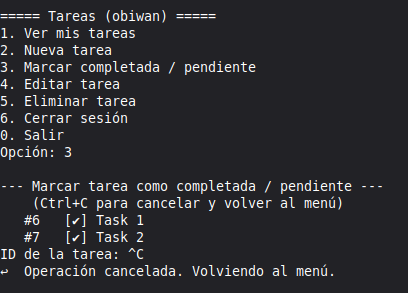

### 11. Acceso desde el navegador — solicitud de credenciales

<!-- Navegador en http://localhost:5000/tareas mostrando el cuadro de usuario/contraseña -->
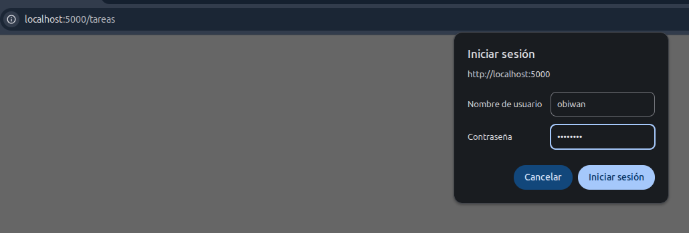

### 12. Acceso desde el navegador — página de bienvenida

<!-- Navegador mostrando "¡Bienvenido/a, ...!" con la lista de tareas -->
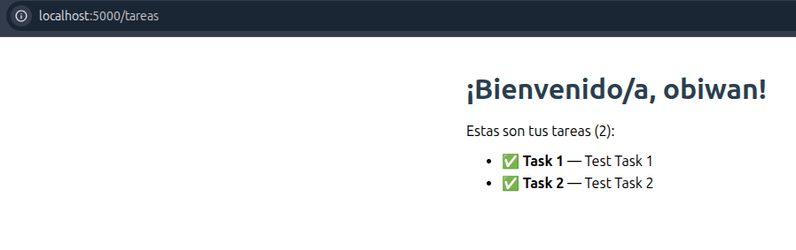

### 13. Contraseñas hasheadas en la base de datos

<!-- Terminal con la consulta a la tabla usuarios mostrando los hashes scrypt -->
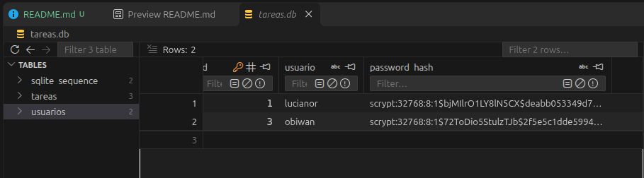

## Respuestas conceptuales

### ¿Por qué hashear contraseñas?

Guardar contraseñas en texto plano implica que cualquiera que acceda a la base de datos (un atacante que la roba, una copia de seguridad expuesta o un empleado con acceso) puede leerlas y usarlas directamente. El riesgo se extiende fuera del sistema porque muchas personas reutilizan la misma contraseña en otros servicios.

Un **hash** es una función **unidireccional**: a partir de la contraseña se obtiene un valor que no permite recuperar el original. Para validar un inicio de sesión no hace falta conocer la contraseña, alcanza con hashear la que ingresa el usuario y compararla con el hash guardado. Así:

- **Una filtración de la base no expone las contraseñas reales**, solo hashes inservibles para iniciar sesión.
- **Nadie que administre el sistema conoce las contraseñas** de los usuarios.
- **El *salt*** (valor aleatorio distinto para cada usuario) hace que dos contraseñas iguales produzcan hashes diferentes e inutiliza las tablas precalculadas (*rainbow tables*).
- **Los algoritmos lentos a propósito**, como *scrypt* (usado en este proyecto mediante Werkzeug), hacen que probar millones de contraseñas por fuerza bruta sea muy costoso.

Por esa razón no se usan funciones rápidas como MD5 o SHA-256 solas, sino funciones diseñadas específicamente para contraseñas (scrypt, bcrypt, Argon2, PBKDF2).

### Ventajas de usar SQLite en este proyecto

- **Sin servidor ni configuración:** la base es un único archivo (`tareas.db`) que se crea automáticamente. No hay que instalar, configurar ni mantener un motor de base de datos aparte.
- **Incluido en Python:** el módulo `sqlite3` forma parte de la biblioteca estándar, por lo que no agrega dependencias.
- **Portabilidad:** el archivo se puede copiar, respaldar o mover entre sistemas operativos sin cambios.
- **SQL estándar y transacciones ACID:** permite usar claves primarias, restricciones `UNIQUE`, claves foráneas y transacciones. Los conocimientos y las consultas se trasladan fácilmente a motores como PostgreSQL o MySQL.
- **Rendimiento adecuado** para una aplicación de baja concurrencia como esta.
- **Ideal para desarrollo, pruebas y aprendizaje:** permite enfocarse en la lógica de la API sin la complejidad de administrar infraestructura.

Como contrapartida, SQLite no está pensado para muchas escrituras concurrentes ni para que varios servidores accedan a la misma base por red. Para una aplicación en producción con muchos usuarios convendría migrar a un motor cliente-servidor.
